<div align="center">

# CONDIMENTAL

**Condiment production, automated.** A Factorio-like factory-automation game about
making sauce — tomatoes and sugar in one end, boxed ketchup and boxed BBQ out of the
loading dock at the other, against standing orders that pay you for keeping them fed.

[](docs/DEVLOG.md)
[](LICENSE)
[](sim_core/)
[](godot_project/)
[](assets/voxels/)

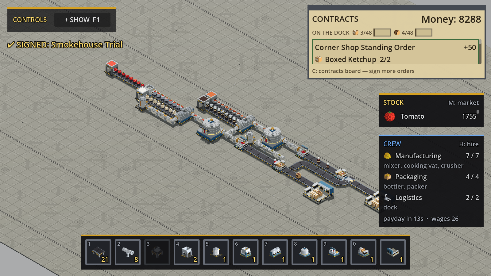

</div>

---

## What it is

A deterministic **Rust** simulation core drives a **Godot 4 / GDScript** presentation
layer through `gdext`. The world starts as an empty factory hall and 3,000 in the
bank: you buy every belt, pipe and machine, lay them out, feed them raw ingredients,
sign contracts, hire the crew that runs the machines, and try to make the income
outpace the ingredients and the wage bill.

- **A real production chain, not a façade.** Tomatoes are crushed into paste, blended
  with sugar and vinegar into a liquid mix, cooked in a 2×2 vat, bottled, boxed, and
  shipped off a loading dock — every stage with its own throughput.
- **Two sauces, and the second one is a *branch*.** BBQ is not a parallel factory: it
  taps the pipe leaving the ketchup vat and takes finished ketchup as an *ingredient*,
  along with spice mix, molasses and liquid smoke. The two sauces compete for one
  vat's output, and the BBQ cook's 600 ticks against ketchup's 240 splits it 3 boxed
  ketchup to 2 boxed BBQ. No new machine kind was needed — a mixer and a vat each run
  more than one recipe now.
- **Belts *and* pipes.** Solids ride conveyors (with corners, merges and splitters);
  the middle of the line is plumbed, because that is what a sauce plant looks like.
  Pressure equalises along a pipe run, every run is named by the fluid it carries and
  tinted for it, and the cooking vat is the one machine no belt ever touches.
- **Contracts, not a spot market.** Standing orders for a quantity of goods on a
  recurring cadence, signed off a board for a price. Miss a window too many times in a
  row and the order is *lost* — it goes back on the board to be signed again. Orders
  that demand a **mix** of both sauces are on the board now, and a mix is
  all-or-nothing: the reason to diversify is in front of the player rather than in a
  design doc.
- **Progression is a gate on the content, not a tech tree.** BBQ's three ingredients
  and its four contracts are held back until your tenth lifetime delivery, so a new
  game's market and board show only what a one-sauce factory can use.
- **Staff as a capacity constraint.** Four categories (manufacturing, engineering,
  packaging, logistics). Machines need a crew to run at all, wages come out of the
  same money counter every payday, and an unpaid head idles before it walks. Anything
  that asks for a crew can be **mothballed** — switched off, off the payroll, holding
  the batch it was part-way through — which is the way out of an unpaid spiral that
  used to have no exit.
- **Production statistics.** A Factorio-style production screen: what the factory made
  and used per item and per fluid over rolling windows, with per-minute rates.
- **Code-generated voxel art.** Every model in the game is emitted by a Rust generator
  from one shared palette — no hand-authored `.vox` files, no flat textures.
- **Deterministic and saveable.** Fixed-point maths only (no `f32`/`f64`) in shared
  simulation state, so a tick is reproducible; the whole world round-trips to a save
  file, and the game autosaves every three minutes.

## Gallery

<table>
<tr>
<td width="50%">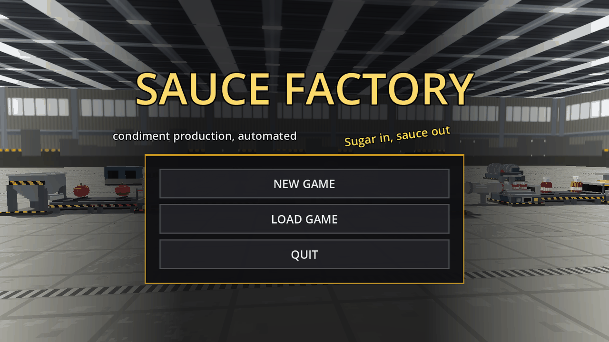<br><sub><b>The title screen</b> — a hand-composed still life of the line, in the same hall you play in.</sub></td>
<td width="50%">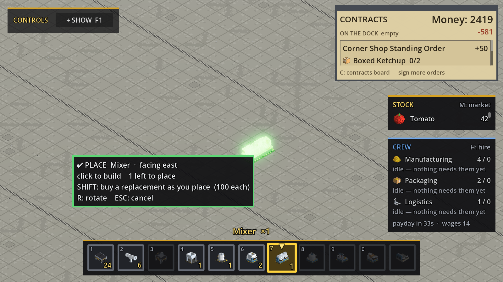<br><sub><b>Build mode</b> — a translucent ghost, a facing, and a prompt that says <code>✔ PLACE</code> or why it will not.</sub></td>
</tr>
<tr>
<td width="50%">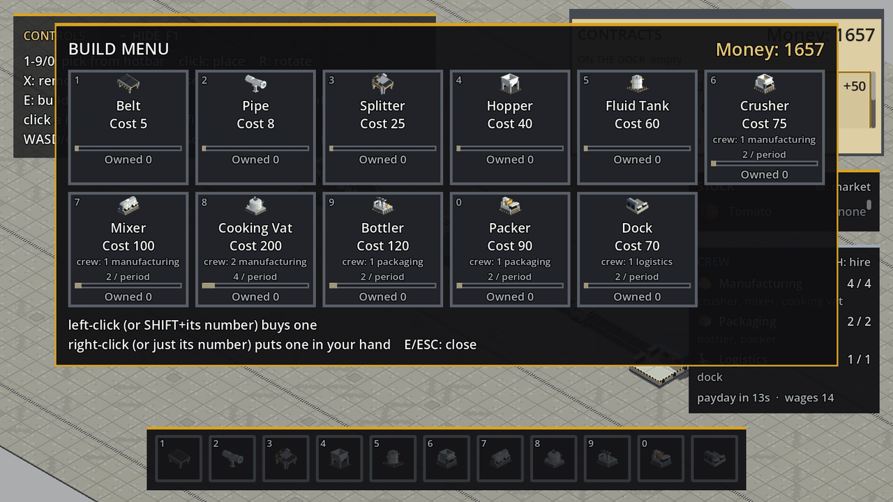<br><sub><b>Build menu (E)</b> — all eleven buildable kinds, each with its price and the crew it will ask for.</sub></td>
<td width="50%">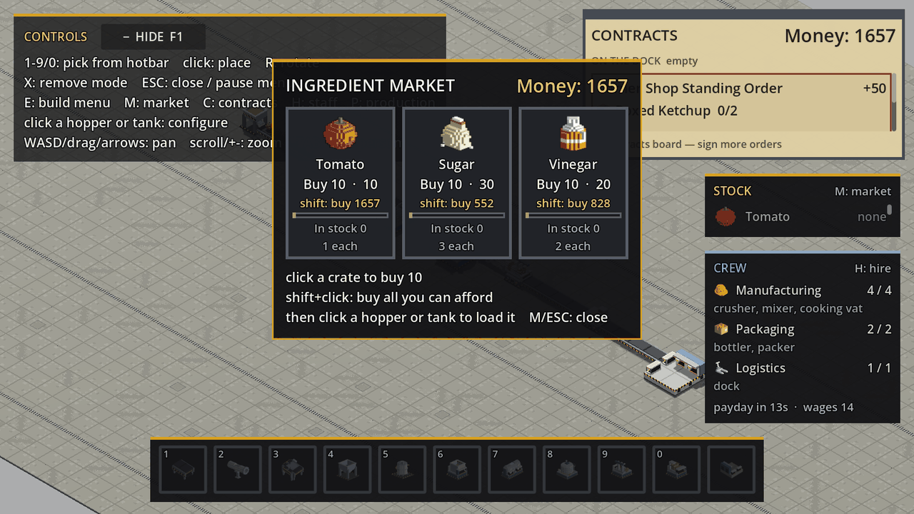<br><sub><b>Market (M)</b> — all six raws, bought by the crate. A new game sees the first three; spice mix, molasses and liquid smoke arrive with the BBQ unlock.</sub></td>
</tr>
<tr>
<td width="50%">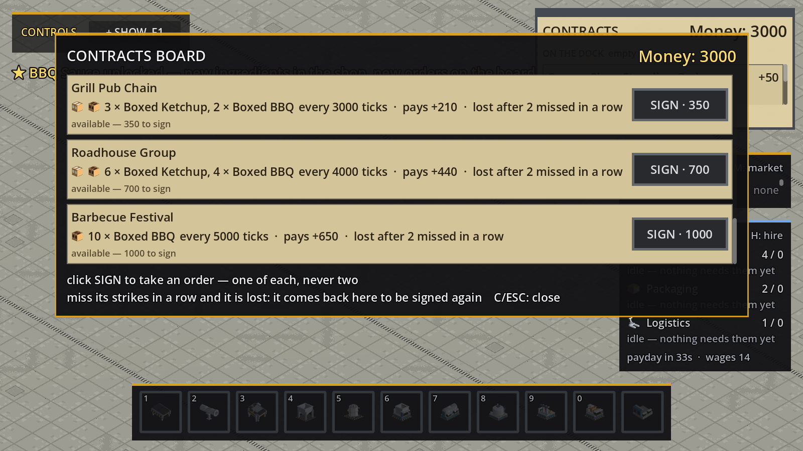<br><sub><b>Contracts board (C)</b> — thirteen offers, from a corner shop to a barbecue festival. The mixed ones name both sauces and pay nothing until both are on the dock.</sub></td>
<td width="50%">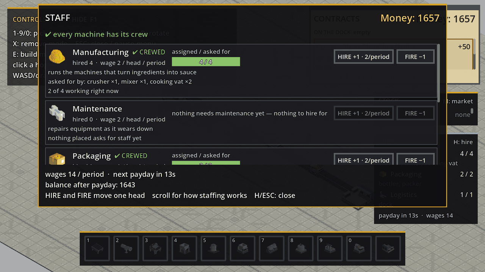<br><sub><b>Staff (H)</b> — hired against asked-for, per category, with the machines doing the asking, the wage bill and the payday countdown.</sub></td>
</tr>
<tr>
<td width="50%">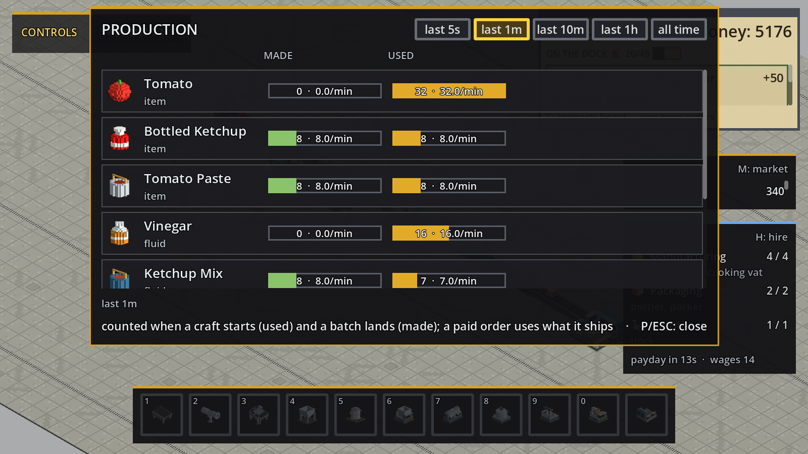<br><sub><b>Production (P)</b> — made and used per item and fluid, over 5s to 1h windows or all time.</sub></td>
<td width="50%">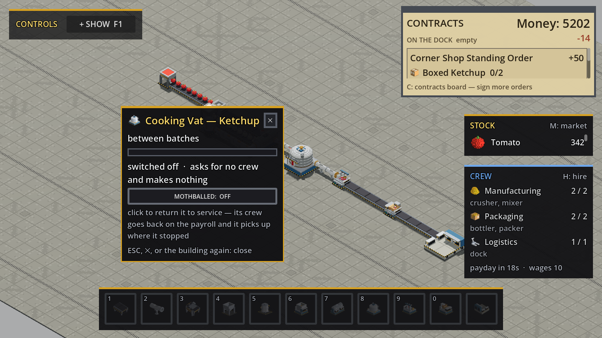<br><sub><b>Mothballing</b> — click any crewed building to switch it off. It holds its part-finished batch, its crew comes off the payroll, and the wage bill falls the same tick.</sub></td>
</tr>
<tr>
<td width="50%">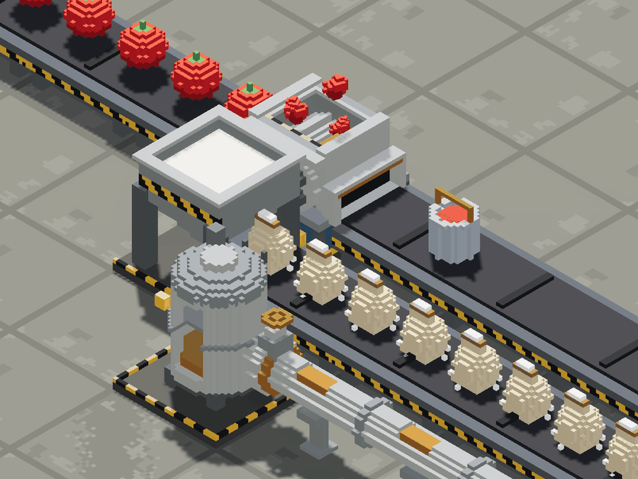<br><sub><b>The crusher</b> — whole tomatoes in, pails of paste out, beside the sugar hopper's parallel lane.</sub></td>
<td width="50%">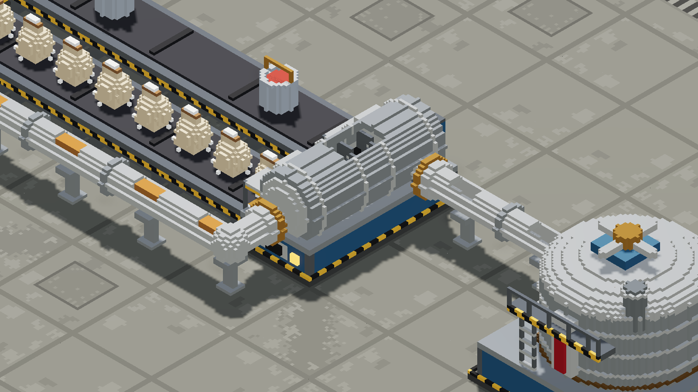<br><sub><b>The mixer</b> — paste and sugar in on two belt lanes, vinegar in by pipe, ketchup mix out into another.</sub></td>
</tr>
<tr>
<td width="50%">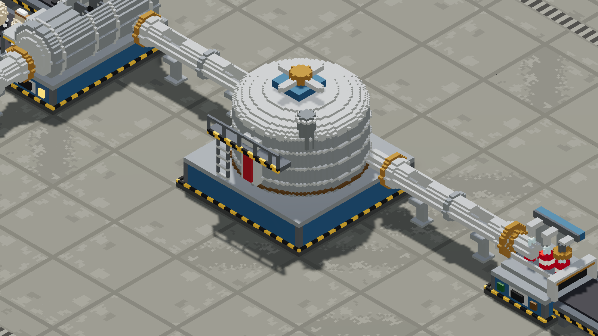<br><sub><b>The cooking vat</b> — 2×2, piped in and piped out, agitator turning while it works.</sub></td>
<td width="50%">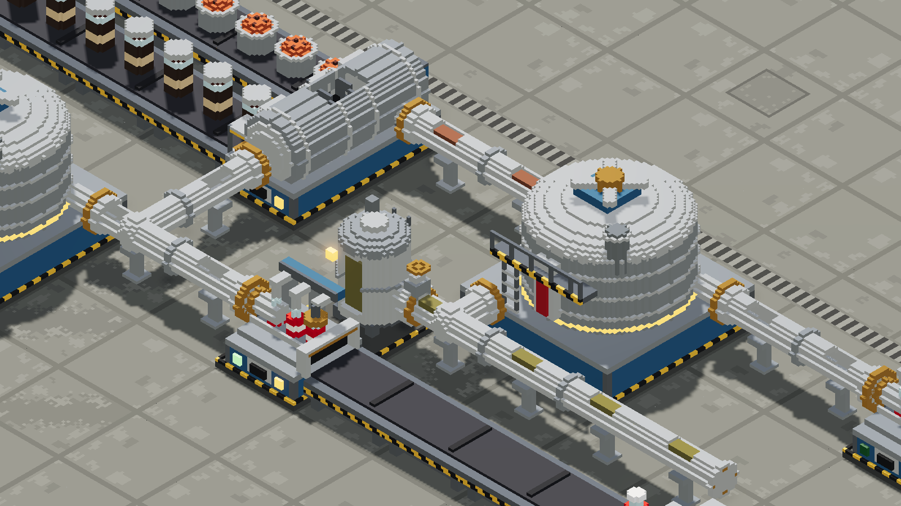<br><sub><b>The BBQ branch</b> — molasses and spice mix on the belt, liquid smoke in its own tank, and a second vat on a pipe run tinted for what it carries.</sub></td>
</tr>
<tr>
<td colspan="2">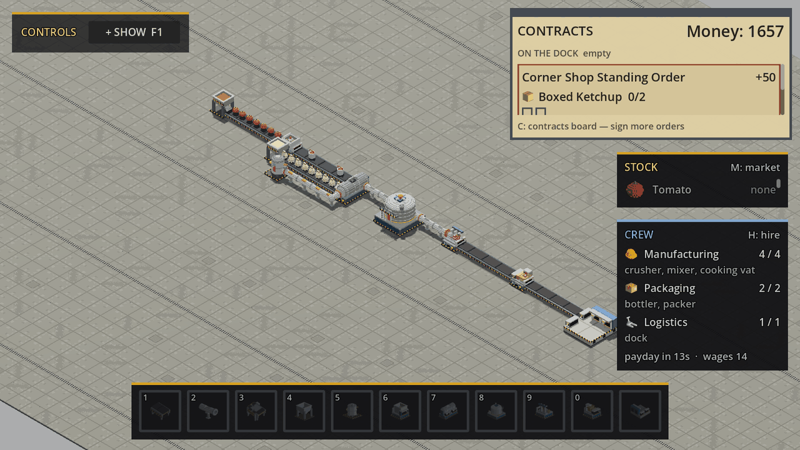<br><sub><b>The shipped line, on its own</b> — hopper to dock, before the branch is tapped off it. This is what a new game builds first.</sub></td>
</tr>
</table>

## The chain, as shipped

Every model below is a real in-game asset, rendered straight out of the voxel pipeline.

**The ketchup line** — what a new game builds:

<div align="center">

|    |  |  |  |  | 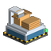 |  |
|:--:|:--:|:--:|:--:|:--:|:--:|:--:|
| tomato · sugar · vinegar | **crusher**<br>4 tomato → paste<br>*80t* | **mixer**<br>paste + sugar + 2 vinegar → mix<br>*90t* | **cooking vat**<br>mix → ketchup<br>*240t* | **bottler**<br>ketchup → bottle<br>*60t* | **packer**<br>bottle → box<br>*40t* | **dock**<br>ships every tick |

</div>

**The BBQ branch** — unlocked on your tenth delivery, tapped off the pipe leaving the
ketchup vat, and running on a second mixer, vat, bottler and packer:

<div align="center">

|    |  |  |  |  |
|:--:|:--:|:--:|:--:|:--:|
| spice mix · molasses · liquid smoke | **mixer**<br>ketchup + spice mix + molasses → BBQ mix<br>*90t* | **cooking vat**<br>BBQ mix + liquid smoke → BBQ<br>*600t* | **bottler**<br>BBQ → bottle<br>*60t* | **packer**<br>bottle → box<br>*40t* |

</div>

Nothing above is hardcoded. Recipes, machine footprints, crews, prices, ingredients,
contracts, unlock gates and staff categories are all data in [`data/*.ron`](data/) —
BBQ was added as a content change with no behaviour change in `sim_core/src/`, and the
next sauce is meant to go the same way.

## Install and play

No binary releases yet (see [Releases](#releases)); you build it from source. It takes
about five minutes, most of which is one Rust compile.

### 1. Prerequisites

| You need | Version | Notes |
|---|---|---|
| [Rust](https://rustup.rs/) | 1.98.1 or newer, edition 2024 | `curl --proto '=https' --tlsv1.2 -sSf https://sh.rustup.rs \| sh` |
| [Godot](https://godotengine.org/download/) | **4.6.3-stable**, standard build | Not the .NET/C# build. The version is pinned — see [ARCHITECTURE.md §1a](docs/ARCHITECTURE.md) |
| `git` | any | |

Put the Godot binary on your `PATH` as `godot` (on macOS:
`ln -s "/Applications/Godot.app/Contents/MacOS/Godot" /usr/local/bin/godot`), or point
every script at it with `export GODOT_BIN=/path/to/godot`.

Platforms: developed and played on macOS (Apple Silicon); Linux and Windows build the
same way. An Android export has been proven working; iOS is blocked (see
[ARCHITECTURE.md §9a](docs/ARCHITECTURE.md)).

### 2. Build

```bash
git clone https://github.com/TomWhitticase/condimental.git
cd condimental
cargo xtask
```

`cargo xtask` is the whole build. It compiles `sim_core`, copies the compiled library
into `godot_project/bin/` where `sim_core.gdextension` expects it (ad-hoc re-signing it
on macOS, which the OS requires after the file is replaced), stages the voxel models
and UI icons into `godot_project/voxels/`, and then runs Godot's asset importer
**twice** (the `.vox` importer is an editor plugin that only registers on the pass after
the first scan — one pass leaves you with an invisible world).

The default is a debug build; `cargo xtask --release` builds the optimized one (slower
to compile, and the only build worth reading a performance number off).

### 3. Play

```bash
godot --path godot_project
```

That opens the title screen. **NEW GAME** starts you on a bare factory floor with
3,000 in the bank — the world is empty by design, and you buy and place every tile.

Want a factory to poke at instead of building one? Write the demo saves and pick one
from **LOAD GAME**:

```bash
scripts/make-demo-saves.sh
```

Saves live in Godot's per-user data directory, not in the repo (on macOS:
`~/Library/Application Support/Godot/app_userdata/CONDIMENTAL/saves`). The running
game prints the resolved path once at startup. The save schema is at version 4 and an
older save is **refused by number rather than migrated**, so re-run that script after
pulling a schema bump.

### 4. Check it works (optional)

```bash
scripts/verify-core-loop.sh
```

26 Rust test suites and 37 headless Godot proofs, including the real `gdext` JSON
boundary, save/load round trips, the second sauce running as a branch off the first,
and the interactive scene's input path. For a picture instead of a pass/fail:

```bash
scripts/screenshot-scene.sh out.png 1600x900 --fixture chain --populate
```

The screenshot harness refuses a flag it cannot honour and a fixture it cannot build,
rather than quietly handing back a frame of something else — `--bbq` photographs the
branch, `--unlocked` puts the world past every progression gate, and `--closeup X,Y,S`
aims at one tile. `scripts/asset-browser.sh` spins every voxel model on its own, lit
the way the game lights it.

<details>
<summary><b>Troubleshooting</b></summary>

- **The world is empty and no machines appear in a demo save.** The asset import did
  not complete. Run `godot --headless --path godot_project --import` twice, or just
  `cargo xtask` again.
- **A demo save will not load at all.** It was written against an older save schema;
  re-run `scripts/make-demo-saves.sh`.
- **`cargo: command not found`.** `~/.cargo/env` is not sourced in this shell; open a
  new terminal after installing rustup.
- **`git status` shows `godot_project/project.godot` modified after you ran the game.**
  Godot rewrites that file in canonical form, stripping its comments. Don't commit it —
  `git checkout godot_project/project.godot`.
- **A script can't find Godot.** `export GODOT_BIN=/absolute/path/to/godot`.
- **Failed extension load / "can't open dynamic library".** The library is gitignored
  build output, so a fresh clone has none until `cargo xtask` runs. Re-run it.

</details>

## How to play

### Controls

| Key | Does |
|---|---|
| `1`–`9`, `0` | Pick that hotbar slot up — puts one in your hand, ready to place |
| left click | Place what is in your hand, or click a placed building to configure it |
| `R` | Rotate — the ghost while placing, or whatever is under the cursor |
| `X` | Remove mode — click to pick a placed tile back up into your inventory |
| `SHIFT` while placing | Buy a replacement as each one goes down |
| `E` | Build menu — buy belts, pipes, machines, buildings |
| `M` | Ingredient market — buy raw ingredients by the crate |
| `C` | Contracts board — sign orders, re-sign lost ones |
| `H` | Staff — hire and fire per category |
| `P` | Production statistics |
| `F1` | Fold the on-screen keybind legend away |
| `TAB` | Swap between the isometric view and a first-person walk-through |
| `WASD` / drag / arrows, scroll / `+` `-` | Pan and zoom (isometric); move and look (first person) |
| hover a machine | Its recipe, buffers, crew, and whether it is working, starved, blocked, uncrewed or switched off |
| `ESC` | Close what is open — else the pause menu (save, sound, music, quit) |

Configuring is a click, not a keybind: a **hopper** gets a picker for which solid it
meters onto the belt, a **fluid tank** gets one for which raw fluid it holds (and says
whether that name was read off the pipe run or stated by you), both get **FILL** and an
**AUTO-FILL** switch, and anything that asks for a crew gets a **mothball** switch.

### Your first factory

1. **Buy the line.** Press `E`. The shipped chain — hopper, belts, crusher, a second
   hopper for sugar, mixer, fluid tank, pipes, cooking vat, bottler, packer, dock —
   comes to about 960, so a new game can afford all of it outright with change to
   spare for ingredients.
2. **Lay it out.** Pick a slot with a number key and click to place. Two rules decide
   whether things connect: **a belt carries toward the way it faces**, and **a machine
   takes input on the face opposite the way it points and discharges out the face it
   points at**. `R` rotates. The mixer is 1×2 and needs *two* feed tiles (paste on one
   lane, sugar on the other) — two ingredients merged onto one belt will deadlock.
3. **Plumb the middle.** The mixer's output is a fluid, so run **pipes**, not belts,
   from mixer → cooking vat → bottler. Vinegar comes from a fluid tank into the mixer
   the same way. The bottler is where the product becomes solid again.
4. **Buy stock and feed it.** Press `M`, buy tomato, sugar and vinegar (`SHIFT`+click
   buys everything you can afford). Then **click** a hopper or a tank to fill it, set
   it to auto-fill from bought stock every tick, and tell it what it holds. Retargeting
   is destructive — it empties the hopper, and a tank also purges every pipe run it
   feeds — so the picker names the total it is about to destroy before it does it.
5. **Sign orders.** Press `C`. A new game starts with no order signed: the board
   on the right lists every offer (later tiers unlock as you deliver), each with a
   price to sign, a quantity, a cadence and a number of strikes, and the column on
   the left holds the orders you are running. The clipboard in the corner tracks every signed order: checklist, payout,
   countdown, and whether it is `✔ READY`, `⚠ AT RISK` or `⚠ LAST CHANCE`.
6. **Watch the money.** Finished boxes wait on the dock they arrive at until a
   contract collects them — one box pays one contract, never two. A dock has 32
   places; once they are all taken it refuses deliveries and the belt backs up.
   Ingredients are roughly a third of revenue, so overproducing onto a dock nobody
   is buying from is a real loss.
7. **Mind the crew.** Press `H`. Every machine you place adds to what a category asks
   for, whether or not it is running; wages are paid every 1,000 ticks (about 33
   seconds at the 30 Hz tick). A payday you cannot cover idles heads for a period, and
   they leave if the next payday is short too. If the bill is the problem, **click a
   building and mothball it** — it stops asking for crew immediately, holds whatever
   it was mid-batch, and picks up where it stopped when you switch it back on.
8. **Find the bottleneck.** Hover any machine for `working` / `starved` / `blocked`, a
   busy percentage and the reason it is waiting — the load bar's *fill* is the
   quantity and its *border* is the state, so an uncrewed machine still reads as one.
   Press `P` for the whole factory's throughput. The cooking vat's 240-tick cycle is
   the longest stage on the ketchup line, so that is where it backs up first.
9. **Open the second sauce.** Your tenth delivery unlocks BBQ: three new raws in the
   market, four new orders on the board, two of which want both sauces at once. Tap a
   pipe off the run leaving the ketchup vat and feed a second mixer — BBQ eats finished
   *ketchup*, so the branch is a decision about how to split one vat's output, not a
   second factory bolted on beside the first.

## Under the hood

```
data/           content: recipes, machines, ingredients, shop, contracts, unlocks, staff
sim_core/       the Rust simulation (src/sim/ is pure, src/lib.rs is the gdext edge)
godot_project/  the Godot 4 presentation layer
assets/voxels/  voxel asset pipeline — generators are the source, models/ is output
xtask/          `cargo xtask`: build sim_core, stage the library and models for Godot
scripts/        verification, voxel build, screenshot review, asset browser
tools/          dev tools that are not part of the game (asset-browser/, legibility/)
docs/           design docs and history
```

Four rules hold the project together, and every one of them is load-bearing:

- **Gameplay logic lives in Rust, never in GDScript.** Godot renders, formats and
  sorts; the simulation decides. Anything deterministic or persisted belongs to
  `sim_core`, behind one `SimBridge` interface of JSON commands and snapshots.
- **Content is data, never code.** If a content change needs a Rust change, a data
  field is missing.
- **No `f32`/`f64` in shared simulation state** — fixed-point (`Fx`, `Money`) only.
  Determinism is a hard requirement, not an aspiration.
- **Art is generated, not drawn.** One `palette.ron`, one Rust generator per asset,
  and the same models feed both the world and the UI icons.

The design docs are authoritative and explain *why* each choice was made:
[ARCHITECTURE.md](docs/ARCHITECTURE.md) (stack, ECS, interop, save format, milestones),
[UI_UX.md](docs/UI_UX.md) (camera, voxel pipeline, UI style, feedback),
[GAMEPLAY.md](docs/GAMEPLAY.md) (loop, progression, economy, contracts, staff),
[WORKFLOW.md](docs/WORKFLOW.md) (build, verify, ship), plus a dated
[DEVLOG](docs/DEVLOG.md) and a [decisions log](docs/DECISIONS_LOG.md).

## How this project is built

CONDIMENTAL is developed almost entirely by AI coding agents working in parallel
worktrees, with a human owner directing and playtesting. That only works with real
engineering discipline around it, so the repository is set up to be legible to an agent
that starts every session with no memory of the last one:

- **A context map, not a context dump.** The root [`AGENTS.md`](AGENTS.md) (the
  [agents.md](https://agents.md/) convention) is a short list of invariants that points
  at the doc covering each task, with per-area files in `sim_core/`, `godot_project/`
  and `assets/voxels/`. Always-loaded context is under a thousand tokens; everything
  else is read on demand, which is cheaper *and* keeps the agent reading the reasoning
  rather than a summary of it.
- **Repeatable procedures are skills**, not prose: adding a voxel asset, verifying,
  reviewing a screenshot, recording a decision, opening a PR, filing an issue.
- **Verification is headless and deterministic**, so an agent can prove its work
  without a human watching a screen — one script runs the Rust suites and every Godot
  proof through the real interop boundary. The one check that cannot be headless
  (*does it look right?*) is a scripted render the agent has to open and read, and that
  harness is built to **refuse** rather than hand back a frame of the wrong thing.
- **CI runs the checks a session might skip.** Workflows under `.github/workflows/`
  cover the Rust and voxel-generator tests, a fmt/clippy ratchet whose baseline is now
  zero, the project's own grep-able rules, `shellcheck`/`actionlint`, a `cargo audit`,
  and the full Godot gate nightly or on demand.
- **Every pull request shows the change in a screenshot.** A local hook and a CI job
  both refuse a PR body without an image.
- **[Conventional Commits](https://www.conventionalcommits.org/)**, enforced by a
  `commit-msg` hook and re-checked in CI, so the history stays usable as a changelog
  source.
- **Decisions are recorded** in the style of an
  [architecture decision record](https://adr.github.io/) — a one-line rule in the
  condensed log, the full reasoning in the archive, and a note in the doc it affects —
  so a settled question is not re-litigated by the next session.
- **Anything noticed and not fixed becomes a GitHub issue**, labelled `deferred`. A
  finding mentioned only in a closing message is lost.

[CONTRIBUTING.md](CONTRIBUTING.md) has the mechanics: commit format, branch and PR
flow, issue templates, and when the DEVLOG needs an entry.

## Roadmap

Milestones 1–7 are done: the scaffold, a mobile export spike, the core loop, a full
multi-stage chain, the economy, fluids and timed processes — plus the epics that made
it a game rather than a demo (shop and inventory, real placement, splitters, the piped
chain rework, the delivery dock, contracts as data, the staff pool, production
statistics, save/load, and a music and sound pass). **BBQ shipped as the second sauce**,
which proved the thing it was built to prove: a sauce is content, and a branching chain,
a gated unlock and a mixed order all work without new Rust.

**Next, roughly in order:**

| | Plan |
|---|---|
| **Scale-up** (milestone 8) | Power as a network, a tiered update scheduler, chunk activity tracking; stress-tested into the thousands of entities |
| **Logistics expansion** (milestone 9) | Transport between factory sites |
| **Platform polish** (milestone 10) | Mobile touch controls and export, packaging, a full UI pass |
| **More sauce** (content) | Mayo (a new emulsifier machine), hot sauce (acid-resistant equipment, fermentation), then aged and derived sauces — chilli mayo needs mayo *and* hot sauce, so the sauce list becomes a dependency tree rather than a list |
| **Multiplayer** (stretch) | Designed for in the architecture, deliberately deferred |

The current open backlog is [GitHub issues](https://github.com/TomWhitticase/condimental/issues);
`docs/DEVLOG.md` is what has actually been built, dated.

## Releases

None yet. CONDIMENTAL is heading for an **alpha** release — the core loop closes and
it is genuinely playable, but there is no packaged build yet, no balance pass on any of
the placeholder numbers, and save files are rejected rather than migrated when the
schema moves. Build from source as above.

The plan is two ways to play the same game: **free**, by building it from this
repository (always), and a small price on **Steam** for anyone who would rather have a
one-click install with updates — buying it there is how you support development. The
Conventional Commit history becomes the release notes.

## Licence

CONDIMENTAL's source code is free software under the
[GNU General Public License v3](LICENSE) (`GPL-3.0-only`): build it, play it, change
it and share it, and any version you distribute stays open source too. An
[additional permission](LICENSE-EXCEPTION.md) lets a build link platform SDKs such as
Steamworks (achievements, cloud saves) without that SDK having to be open. The
**name and brand** are not part of that grant — a fork you publish needs its own name;
[TRADEMARKS.md](TRADEMARKS.md) says what is and is not fine. Third-party software the
game is built on, and its licences, is listed in
[THIRD_PARTY_NOTICES.md](THIRD_PARTY_NOTICES.md).

Found a bug? [Open an issue](https://github.com/TomWhitticase/condimental/issues/new/choose).
A security problem goes through [SECURITY.md](SECURITY.md) instead, and everyone taking
part follows the [code of conduct](CODE_OF_CONDUCT.md).

---

<div align="center">
<sub>Pre-alpha · <a href="LICENSE">GPL-3.0</a> · the name and brand are reserved (<a href="TRADEMARKS.md">TRADEMARKS.md</a>)</sub>
</div>
